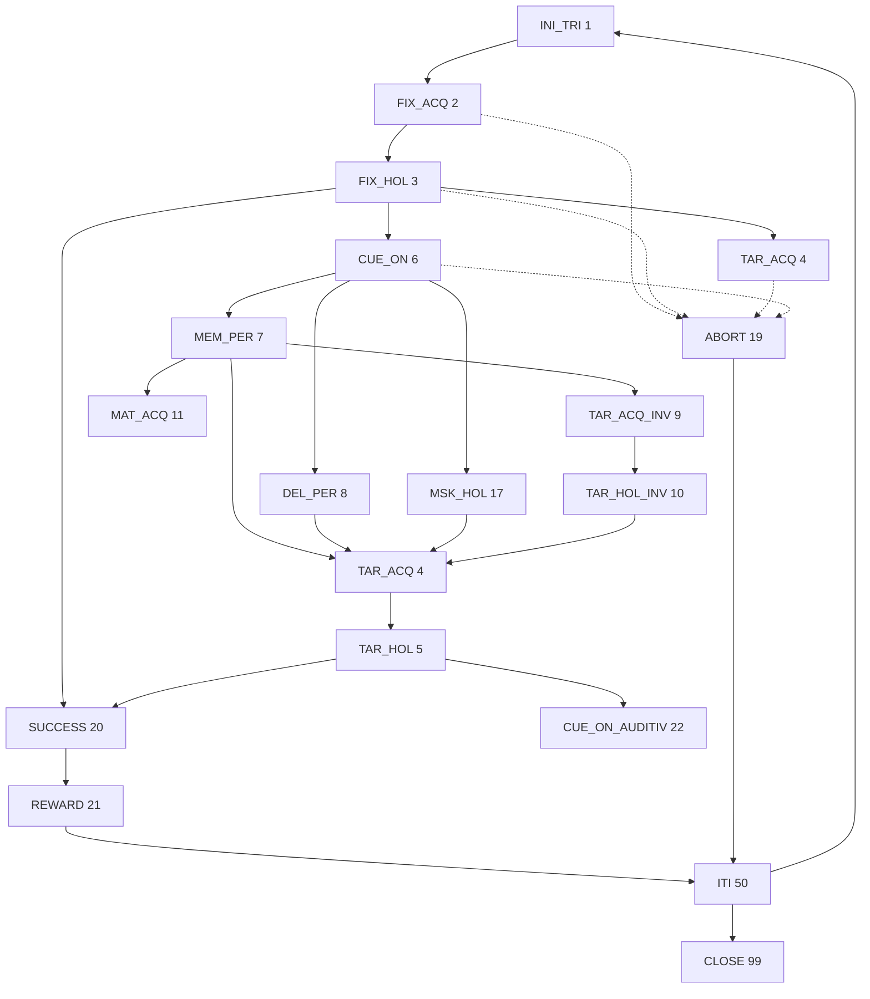

# monkeypsych

MATLAB real-time behavioral controller for macaque (and human) psychophysics and electrophysiology. Psychtoolbox draws the stimulus display; a state machine gates eye/hand/sensor behavior; NI/MCC DAQ plus a parallel port talk to reward, sensors, microstim, and TDT; each run is saved as a `.mat` that [ma1](https://github.com/igor-kagan/ma1) reads.

DAG / German Primate Center. GitHub: [dagdpz/monkeypsych](https://github.com/dagdpz/monkeypsych). Wiki is mostly empty; this file is the working spec.

**This document is the pre-revision map.** Do not treat `all_monkeypsych_versions/` as source — it is an ad-hoc dump of dated `monkeypsych.m` copies written by `autosave_changed_monkeypsych`. Live code is the repo root.

---

## Related repositories

| Repo | Role |
|------|------|
| **this repo** | Controller, hardware, display, save |
| [`monkeypsych_conditions`](E:/Dropbox/Sources/Repos/monkeypsych_conditions) | Per-subject task/condition scripts. One folder per monkey. Injected via `run(task.custom_conditions)` into the controller workspace |
| [`ma1`](E:/Dropbox/Sources/Repos/ma1) | Offline analysis of the `.mat` run files (`trial` struct array). Optional TDT-combined ephys. State dictionary in `ma1_task_state_dictionary.m` |

Conditions used to live inside this repo (`conditions/`). They were split out (`git` commit `8dc9077 remove conditions`). `get_monkey.m` still points at old `D:\Sources\MATLAB\monkeypsych_3.0\conditions\...` paths. That is the live wiring until it is rewritten.

`ma1` also depends on **em** (saccade detection) and **ig** (plot helpers). This repo vendors thin copies of `ig_randsample` and `ig_add_multiple_vertical_lines`.

---

## How a session is organized

```
session (one experimental day, folder YYYYMMDD)
  run  (one .mat, auto-numbered _01, _02, ...)
    block (optional; encoded in the condition script as multiple experiments)
      trial (state-machine cycle)
```

Launch:

```matlab
monkeypsych(monkey, setup_code)
% e.g. monkeypsych('Linus', 3)
```

- `monkey` → `get_monkey.m`: data path, viewing distance, **absolute path** to the condition file
- `setup_code` → `get_setup.m`: screens, DAQ, parallel-port addresses, TDT routing, GUI geometry

Output file:

```
{DATA_PATH}\{YYYYMMDD}\{monkey_name}{yyyy-mm-dd}_{run:02d}.mat
% e.g. D:\Data\Linus\20260817\Lin2026-08-17_01.mat
```

During the run, each trial is written to a temp folder of the same name as the `.mat` (`Lin2026-08-17_01\..._0001.mat`, ...). On graceful close (`Esc` in ITI / INI_TRI, or condition script sets `dyn.state = STATE.CLOSE`), those files are concatenated into the run `.mat` and the temp folder is deleted. Crash mid-run leaves the per-trial files; `mp_concatenate_trial_matfiles` can rebuild.

A copy is also written to `SETTINGS.dag_drive` (typically `Y:`).

Eye calibration (`offset_x/y`, `gain_x/y`) is persisted in `SETTINGS.eyecal` (default `{DATA_PATH}\last_eyecal.mat`) and reloaded next session. A condition file can set `SETTINGS.eyecal` to a `.mat` file, a directory (appends `last_eyecal.mat`), or a relative name (under `DATA_PATH`). Loaded once per distinct path so F1 / online offset updates are not wiped. CLOSE saves to the same path.

---

## Architecture

Four globals: `SETTINGS` (setup, immutable-ish), `STATE` (integer codes), `IO` (DAQ objects), plus the huge `monkeypsych` workspace.

Four live structs, documented at the top of `monkeypsych.m`:

| Struct | Lifetime | Meaning |
|--------|----------|---------|
| `SETTINGS` | session | Hardware, screens, GUI, TDT, paths. Mutated by condition files (`SETTINGS.GUI_in_acquisition`, motion checks, sounds) |
| `task` | run, overwritten every trial by the condition script | Timing, stimuli (`task.eye.*`, `task.hnd.*`), effector, type, reward, microstim |
| `trial(n)` | accumulated | Snapshot of everything about trial `n`, including a copy `trial(n).task` |
| `dyn` | state-to-state | Counters, selected target, abort markers, sample buffer, classifier bytes for TDT |

Control flow:

```
get_setup → get_monkey → init DAQ / PP / TDT / eye tracker / PTB / GUI
  optional scanner trigger wait
  while true
    switch dyn.state          % outer state dispatcher
      INI_TRI: run(conditions), send_trialinfo_to_TDT, wait sensors
      FIX_ACQ / TAR_ACQ / ...: acquisition_state  (inner 1 ms loop)
      FIX_HOL / CUE_ON / ...:  hold_state
      ABORT / SUCCESS / REWARD / ITI / CLOSE
    append states / states_onset
    dyn.state = state_transition(task, success, dyn.state)
```

The **inner loops** (`acquisition_state`, `hold_state`, `wait_while_recording_state`, `ITI_state`) are the “real-time” path: sample eye/hand/sensors, test windows, optional microstim pulse, append a row to `dyn.memoryBuffer`, `WaitSecs('Untiltime', tSample+1ms)`.

This is **not** deterministic DSP timing. MATLAB on Windows + PTB + DAQ + GUI. TDT records neural data independently; sync is an 8-bit digital word of state/trial metadata, not a shared clock.



Exact sequences are `task.type`-specific; see [State machine](#state-machine). Any failure in acquire/hold → `ABORT` (except type 10 wagering, which can still reward).

---

## File map

Live MATLAB (ignore `all_monkeypsych_versions/`):

| File | Lines | Role |
|------|------:|------|
| `monkeypsych.m` | ~3927 | Controller + all local functions (state machine, acquire/hold, stimuli, TDT, save) |
| `get_setup.m` | ~675 | Hardware profiles by integer `setup_code` |
| `get_monkey.m` | ~543 | Subject profiles: `monkey_name`, data path, `task.custom_conditions`, `task.vd` |
| `get_sensors_state.m` | ~68 | Parallel-port pin → bit for rest sensors / motion / scanner trigger |
| `setup_pp.m` | ~23 | `io32` / inpout32 install |
| `get_touch.m` | ~21 | Touchscreen voltage → pixels |
| `deg2pix_xy.m` / `pix2deg_xy.m` / `deg2pix_withOffset.m` / `cm2deg.m` | | Screen geometry. **Formulas are not inverses of each other** — see [Coordinate math](#coordinate-math) |
| `mp_concatenate_trial_matfiles.m` | | Rebuild run `.mat` from per-trial files after a crash |
| `mp_read_conditions.m` | | Legacy tab-delimited condition tables (`dlmread`). Unused if custom condition files are set |
| `mp_condition_positions.m` | | Helper to generate polar target grids for condition files |
| `PEST.m` | | Staircase helper (used from some condition files, not the core loop) |
| `evaluateTrainingDataALL.m` | | Daily hit-rate printout over a session folder |
| `MP_inputdlg.m` | | `inputdlg` vs custom `dag_inputdlg` for MATLAB ≥ 2014 (hotkeys F1–F6) |
| `ig_randsample.m` | | Weighted sample (Stats Toolbox `randsample` clone) |
| `ig_add_multiple_vertical_lines.m` | | ITI GUI state markers |
| `Sounds/mp_Sounds.m` | | WAV reward/failure via PsychPortAudio. Looks for `failure.wav`/`reward.wav` in **repo root**, but the files sit in `Sounds/` |

`dag_inputdlg_add_to_toolbox_matlab_uitools` is a MATLAB `uitools` patch drop-in, not a function on the path.

---

## Core data structures

### `SETTINGS` (from `get_setup`, then patched)

Important fields:

- Display: `whichScreen`, `screen_w/h_pix`, `screen_w/h_cm`, `BG_COLOR`, `vd` (copied from `task.vd`), `screen_uh_cm` (Y origin: cm from top of screen to “straight ahead”)
- Loop: `fsMatlab=1000`, `durTrialMax=20`, `bufferSize`, `figure_drawing_interval=0.1 s`, `FlipSyncMode`
- I/O flags: `ai`, `ao`, `useParallel`, `useSerial`, `use_digital_to_TDT`, `touchscreen`, `useVPacq`, `useViewAPI`, `useMouse`
- TDT: `TDT_interface` (`'DAQ'` or `'Parallel'`), `daq_digital_output_port_to_TDT`
- Motion: `check_motion_jaw/body`, `Motion_detection_interface`, `sensor_pins`
- Scanner: `interface_with_scanner` (0 off, 1 UMG key `'9'`, 2 DPZ PP bit), `TR`, `skip_volumes`, `run_volumes`
- Paths: `BASE_PATH`, `dag_drive`, `MP_PATH`
- Version string: `monkeypsych_YYYYMMDD_HHMM` from `monkeypsych.m` file date

### `task` (defaults in `get_monkey`, overwritten per trial)

- `type` — paradigm (1–12, plus 2.5)
- `effector` — 0..6, see [Effectors](#effectors)
- `choice` — 0 instructed / 1 free choice (usually from condition `instructed_choice_con`)
- `reach_hand` — 0 stay, 1 left, 2 right, 3 either
- `rest_hand` — `[L R]` which home sensors must be held
- `timing.*` — acquire timeouts, hold durations + `_var` jitter, ITI success/fail, grace times, `wait_for_reward`
- `eye.fix / .tar(k) / .cue(k)` and `hnd.*` — `x,y,size,radius,shape,color_dim,color_bright,...` in **deg**
- `reward.time_neutral` — `[t t]` valve-open seconds
- `microstim.fraction / .state / .start{}/.end{}` — optional ICMS
- `custom_conditions` — path to the `run()` script
- `correct_choice_target` — which target indices count as correct (default `[1 2]`; instructed typically `[1]`)

`trial(n).task` is a **copy after** the condition script and after `n_eye_tar` / `n_hnd_tar` have been clipped for instructed trials. Analysis should use `trial(n).*`, not the final `task` in the file (that is last-trial).

### `dyn.memoryBuffer` columns (then copied onto `trial(n)` at ITI)

| Col | Field |
|-----|--------|
| 1 | `tSample_from_time_start` (s from `SETTINGS.time_start`) |
| 2 | `trial_number` |
| 3 | `state` (per-sample) |
| 4–5 | `x_hnd`, `y_hnd` (deg) |
| 6–7 | `x_eye`, `y_eye` (deg) |
| 8–9 | `sen_L`, `sen_R` |
| 10–11 | `jaw`, `body` |

---

## State machine

Defined in `monkeypsych.m` (~L270) and duplicated in `ma1/ma1_task_state_dictionary.m`. **Keep these in lockstep.** Numeric codes are the TDT word and the analysis API.

| Code | Name | Role |
|-----:|------|------|
| 1 | `INI_TRI` | Pick condition, TDT trial header, wait motion/touch/sensors |
| 2 | `FIX_ACQ` | Acquire fixation (eye and/or hand) |
| 3 | `FIX_HOL` | Hold fixation (dim→bright) |
| 4 | `TAR_ACQ` | Acquire target (Go) |
| 5 | `TAR_HOL` | Hold target |
| 6 | `CUE_ON` | Cue visible; still holding fixation |
| 7 | `MEM_PER` | Memory delay, cue off, targets invisible |
| 8 | `DEL_PER` | Delay with targets often still visible |
| 9 | `TAR_ACQ_INV` | Acquire remembered location (invisible target) |
| 10 | `TAR_HOL_INV` | Hold invisible |
| 11 / 12 | `MAT_ACQ` / `MAT_HOL` | Match-to-sample explore/select |
| 13 / 14 | `MAT_ACQ_MSK` / `MAT_HOL_MSK` | Masked M2S |
| 15 | `SEN_RET` | Poffenberger return-to-sensors |
| 16 | `FIX_PER` | RF-mapping cue flashes, stay on fix |
| 17 | `MSK_HOL` | Backward mask after cue (delayed M2S) |
| 19 | `ABORT` | Failure; abort_code string |
| 20 | `SUCCESS` | Completed sequence; still checked vs `correct_choice_target` |
| 21 | `REWARD` | Valve + optional wait |
| 22 | `CUE_ON_AUDITIV` | Auditory cue / wagering |
| 23 / 24 | `TA2_ACQ` / `TA2_HOL` | Second (wager) target |
| 25 / 26 | `FI2_ACQ` / `FI2_HOL` | Second fixation |
| 50 | `ITI` | Flush buffer, save trial, ITI GUI, hotkeys |
| 99 | `CLOSE` | Eye cal save, concatenate, PTB teardown |

`state_transition` walks a `task.type`-specific list. `success==0` → ABORT; `success==-1` steps **backward** (used in type 8 RF flashing: CUE_ON ↔ FIX_PER).

### `task.type` sequences (mid-trial)

All start `INI_TRI` and end `SUCCESS → REWARD → ITI` (or `ABORT → ITI`).

| type | Name | Mid sequence |
|-----:|------|----------------|
| 1 | fixation | FIX_ACQ FIX_HOL |
| 2 | direct saccade/reach | FIX_ACQ FIX_HOL TAR_ACQ TAR_HOL |
| 2.5 | direct + cue/distractor | … CUE_ON MEM_PER TAR_ACQ TAR_HOL |
| 3 | memory | … CUE_ON MEM_PER TAR_ACQ_INV TAR_HOL_INV TAR_ACQ TAR_HOL |
| 4 | delay | … CUE_ON DEL_PER TAR_ACQ TAR_HOL |
| 5 | M2S | … CUE_ON MEM_PER MAT_ACQ MAT_HOL |
| 6 | M2S masked | … CUE_ON MEM_PER MAT_ACQ_MSK MAT_HOL_MSK |
| 7 | Poffenberger | … TAR_ACQ SEN_RET DEL_PER |
| 8 | RF cue flashes | … CUE_ON FIX_PER (can reverse) |
| 9 | delayed M2S + mask | … CUE_ON MSK_HOL TAR_ACQ TAR_HOL |
| 10 | 9 + wagering | … then CUE_ON_AUDITIV FI2_ACQ FI2_HOL TA2_ACQ TA2_HOL |
| 11 | fixation + visual cue | … CUE_ON DEL_PER (no target) |
| 12 | fixation + auditory cue | FIX_ACQ CUE_ON_AUDITIV |

Hold durations: `task.timing.<epoch>_time_hold + rand * _var`. Acquire states are **timeouts** (`fix_time_to_acquire_eye/hnd`, etc.), not holds. Effector 2/3/4 use `max(eye, hnd)` timeout.

### Abort codes

String field `trial.abort_code`. Priority in `get_abort_code`: jaw → body → incorrect hand on FIX_ACQ → sensor release → dirty sensors → wrong target (if `dyn.completed`) → else previous-state × effector (eye vs hand). Cue-offset < 200 ms in MEM_PER is reclassified as `ABORT_*_CUE_ON_STATE`.

---

## Effectors

| `task.effector` | Behavior |
|----------------:|----------|
| 0 | Eye only (saccade). Hand windows ignored. `dyn.effector='eye'` |
| 1 | Free-gaze reach. Eye windows ignored. `'hnd'` |
| 2 | Joint: both must acquire/hold |
| 3 | Dissociated saccade: eye goes to target, hand stays on central hold |
| 4 | Dissociated reach: hand goes to target, eye stays on central hold |
| 5 | Reach-to-sensors (Poffenberger): `sen3/sen4` as targets, return `sen1&&sen2`. Partially wired |
| 6 | Free-gaze reach **after** initial eye fixation (eye windows dropped after FIX) |

`reach_hand` 1/2/3 sets hand-target colors (left blue-ish, right green). Rest sensors: `task.rest_hand = [1 1]` requires both home sensors before INI_TRI proceeds (`task.rest_sensors_ini_time`).

Instructed vs choice: if `~task.choice` and `type<5 || type>=10`, only target 1 is prepared (`dyn.n_eye_tar=1`). Choice trials keep both. `correct_choice_target` can still fail a completed trial (SUCCESS → ABORT).

---

## Hardware I/O

### Display (Psychtoolbox)

`Screen('Openwindow')` on `SETTINGS.whichScreen`. Stimuli built in `aux_FillPar` (deg → pix) and `aux_PrepareStimuli`. Shapes: `circle`, `square`, `square_frame`, `triangle`, `convex`, `bar_masked`, `circle_withBar`, `arrows`. Flip waits for retrace unless `FlipSyncMode` ≠ 0.

Online experimenter GUI: red eye / green hand markers, target windows, optional ITI trace figure (eye/hand x/y vs time, state lines, microstim window).

### Eye

- Arrington ViewPoint (`vpx_*`, `SETTINGS.useVPacq`)
- SMI iView X API (`SETTINGS.useViewAPI`, setup −10)
- Mouse (`SETTINGS.useMouse`) — office/debug

Calibration: `x = (raw - 0.5) * gain + offset` (ViewPoint 0–1 camera FOV). F1 during ITI edits gains/offsets. Optional ViewPoint stimulus-point override (F2 when `vpx_calibration`).

### Hand / touch

NI or MCC `analoginput` channels `SETTINGS.AI_channels` = `[touch_x touch_y jaw body]`. `get_touch` maps voltage with per-setup gain/offset/threshold. `UseMouseAsTouch` for debug.

### Sensors / reward / microstim (parallel port, `io32`)

`SETTINGS.pp.address_inp` / `address_out_reward` / `address_out_TDT`. Pin map in `get_sensors_state` (status port 379 bits). Reward: add `value_out_reward` to the output byte for `reward_time` seconds (`aux_DispenseReward`). Microstim: either DAQ `analogoutput` 5 V pulse (`aux_produce_one_trigger`) or PP bit (`value_out_microstim`, typically pin 6). Negative `microstim_start` means “align to **end** of state”.

Scanner DPZ: extra PP pin as volume trigger (`interface_with_scanner==2`). UMG: keyboard `'9'`.

### Sound

PsychPortAudio. `SETTINGS.SoundType`: `'Beep'` (synthesized) or `'XBI_sounds'` (WAVs via `mp_Sounds`). Flags: INI, fixation-break, sensors-released, touchscreen, motion, reward, wrong-target.

### Setup codes (`get_setup.m`)

| Code | Site |
|-----:|------|
| −10 | Tübingen (SMI) |
| −3, −1 | DAG psychophysics |
| −2 | UMG human scanner (mirror) |
| 0 | UMG monkey scanner |
| **1** | DPZ monkey rig 1 (NI **Dev2**, TDT DAQ) |
| **2, 3** | DPZ monkey rigs 2/3 (NI **Dev1**, TDT) |
| 4 | DPZ monkey scanner |
| 50 | Office |
| 51 | UMG human touchscreen |
| 100 | Lukas laptop |
| 130 | IKDAG (mouse, no PP) |

Setup 3: touchscreen on, TDT via Parallel `D050`, reward `D052`, sensors `D051`. Setup 1/2: TDT via NI `digitalio`.

---

## TDT sync protocol

Not OpenEx/ActiveX. An **8-bit digital word** (`send_to_TDT`) is latched into TDT on every state entry and as a trial header in INI_TRI.

Header (`send_trialinfo_to_TDT`), 1 ms pulses, spacers `254`:

```
252          INI trial
Y,M,D,H,M,S  clock (year mod 100)
run          fileNumber
trial/100, trial%100
trial_classifier[1..N]   % one byte per condition-file field, abs(round(value))
253          end trial
0            all-off control
255          INI states
dyn.state    (1)
```

Then each subsequent state writes its integer code. `CLOSE` sends 99.

`dyn.trial_classifier` is filled by the condition script from the `All` struct **field order**. That order is part of the TDT/analysis contract. Default before `run()` is `250`.

---

## Conditions interface (`monkeypsych_conditions`)

`get_monkey` sets `task.custom_conditions` to an `.m` **script** (not a function). `monkeypsych` does `run(that_path)` twice conceptually: once before scanner wait (trialNumber temporarily 1) and **every INI_TRI**.

The script executes **in the controller workspace**. It may read/write `task`, `dyn`, `trial`, `STATE`, `SETTINGS`, `sequence_indexes`, `shuffle_conditions`, `force_conditions`.

`SETTINGS.eyecal` — optional eye-cal `.mat` path. Set it in the trial-1 block. Default is `{DATA_PATH}\last_eyecal.mat`. Loaded after that `run()`, not at `get_setup` time.

Canonical pattern (`combined_condition_file_*.m`):

1. **Trial 1 only:** build `All` (vectors of factor levels), `combvec` × `N_repetitions` → `sequence_matrix`. Optional block concat of several `esperimentazione` names.
2. Shuffle: `0` ordered, `1` global Shuffle, `2` shuffle within experiment (blocked).
3. **Every trial:** pick `custom_trial_condition` index.
   - `force_conditions==1` — advance only on success; close when all succeeded
   - `2` — unsuccessful trial shuffled back into the pool
   - `3` — same, but keep experiment blocks
   - else — one pass, close when `numel(trial)` matches sequence length
4. Map row → `Current_con.*` → `task.type/effector/reach_hand/choice/timing/size/positions/...`
5. Write `dyn.trial_classifier` from those fields.

`All` field names (Linus file; order = TDT classifier bytes):

`angle_cases, instructed_choice_con, type_con, effector_con, reach_hand_con, excentricities, stim_con, timing_con, size_con, tar_dis_con, mat_dis_con, cue_pos_con, shape_con, offset_con, invert_con, exact_excentricity_con_x/y, reward_con, reward_sound_con, rest_hands_con, var_x, var_y`

Subject folders in the conditions repo: `Bacchus`, `Curius`, `Linus`, `Magnus`, `Pinocchio`, `Human`, `Test`, plus `Old/` (Cornelius, Norman, …). Human / Test live under `Human/` and `Test/`.

`get_monkey` subjects (prefix used in filenames): Test/`IVSfK`, Peter/`S01`, Magnus/`Mag`, Bexter/`Bex`, HumanNeglect/`SU1`, Norman/`Nor`, Cornelius/`Cor`, Curius/`Cur`, HumanM2S/`DW1`, Linus/`Lin`, Bacchus/`Bac`, Pinocchio/`Pin`, Debug/`Deb`. Variants `*_phys` exist. **Feno** appears in ma1 examples but has no `get_monkey` case yet.

---

## Output contract (what ma1 reads)

Each run `.mat`:

```matlab
SETTINGS   % session hardware (from trial 1 file; also last-trial `task` in concatenated file)
task       % last trial's task struct
trial      % 1×N struct array
sequence_indexes
```

`trial(n)` fields ma1 actually uses (preserve names/shapes):

| Field | Notes |
|-------|--------|
| `states`, `states_onset` | Transition list; onsets **absolute** from run start (`GetSecs - SETTINGS.time_start`) |
| `state` | Per-sample, same length as kinematics |
| `tSample_from_time_start` | Same clock as `states_onset` |
| `x_eye`, `y_eye`, `x_hnd`, `y_hnd` | Deg, origin = screen center defined by `screen_uh_cm` |
| `sen_L`, `sen_R`, `jaw`, `body` | |
| `success`, `completed`, `choice`, `effector`, `reach_hand` | |
| `microstim`, `microstim_start/end/state/interval` | Start/end relative to **state entry**, not trial start |
| `reward_time`, `rewarded`, `reward_size`, `reward_prob`, `reward_selected` | |
| `aborted_state`, `aborted_state_duration`, `abort_code` | −1 if success |
| `type`, `n`, `timestamp` | `timestamp` = `datevec` |
| `eye.fix/tar/cue`, `hnd.*` | Stimulus geometry for that trial |
| `task` | Full task snapshot including `timing`, `custom_conditions` path |
| `manual_success` | |

TDT-combined files (produced **outside** this repo) add `TDT_eNeu_t`, `TDT_state_onsets`, etc. ma1’s ephys browsers expect those.

Filename parse in ma1: 3-letter animal + `yyyy-mm-dd` + `_` + 2-digit run.

**Sampling rate is not stored.** ma1 infers `n_samples / trial_duration`. Empirically ~400–1200 Hz, not the requested 1 kHz — loop overruns `WaitSecs` when DAQ/Flip/GUI run.

`states_onset` is absolute; `reward_time` is a **duration** (valve open), not an onset. `microstim_start` is relative to the stimulated state’s entry.

---

## Online hotkeys (ITI or INI_TRI)

`ListenChar(2)` — MATLAB command window is captured.

| Key | Action |
|-----|--------|
| Esc | `STATE.CLOSE` |
| F1 | Eye offset/gain dialog |
| F2 | Override fix/target radii (or ViewPoint cal point) |
| F3 | Override fix/target positions |
| F5 | Override type / effector / reach_hand / reward time |
| F6 | Force-previous-target / extra-reward |

Overrides stick across trials via `task.overriding.*` until cleared.

---

## Coordinate math

Screen origin for deg: horizontal center, vertical at `screen_uh_cm` from the **top** of the screen (not geometric center). That is how chairs/MRI mirrors put “straight ahead” off the panel midline.

Three **different** deg↔cm conventions coexist:

| Function | Formula |
|----------|---------|
| `cm2deg` / `pix2deg_xy` | `2*atan((cm/2)/vd)` |
| `deg2pix_xy` | `vd * tan(deg)` (not the inverse of the above) |
| `deg2pix_withOffset` | eccentricity-corrected `vd/2 * (tan(o+d)-tan(o-d))` for **size** |

`aux_FillPar` then does:

```matlab
stim(3) = deg2pix_withOffset(stim(3), offset_deg);           % size deg → pix
stim(4) = deg2pix_withOffset(stim(3), offset_deg);           % BUG: stim(3) already pixels
```

Window radius used for behavior (`aux_IsWithinRadius`) is the **deg** copy (`par.deg.radius`), so online control is OK; drawn size vs window can disagree. Do not “fix” conversion without a calibration dataset and an ma1 dual-read.

---

## Known hazards (revision-relevant)

Living fix-later list (IDs, priorities, sound/setup/coord items): **[Issues.md](Issues.md)**.

1. **`monkeypsych.m` is a 4k-line function** with ~35 local functions, no `end` on most of them, globals, and `run()` of external scripts. Untestable as-is.
2. **Legacy DAQ API**: `analoginput` / `analogoutput` / `digitalio` / `addchannel` / `putvalue` / `getsample`. Removed from current Data Acquisition Toolbox (session-based `daq` only). This is a hard MATLAB-version ceiling.
3. **`io32` / inpout32** 32-bit parallel port. Fragile on modern Windows; setup 3 uses a PCIe card at `0xD050`.
4. **Condition paths** still `D:\Sources\MATLAB\monkeypsych_3.0\conditions\...`. Repo split is incomplete. `Debug_IKDAG` points at `monkeypsych\conditions\` which no longer exists.
5. **`run(condition_file)`** is `eval`-class coupling. Condition scripts assume `dyn.trialNumber`, `trial`, `STATE`, `combvec`.
6. **`mp_Sounds`** path vs `Sounds/` folder mismatch.
7. **`deg2pix` / `pix2deg` not inverses**; `aux_FillPar` radius overwrite.
8. **Requested 1 kHz is fictional.** Buffer is `20 s * 1000`. Long trials / slow loops will overflow `counterLine` without a guard.
9. **TDT classifier is 8-bit.** Condition values are `abs(round(...))`. Negative offsets and non-integer `type` 2.5 are lossy.
10. **Type 12** skips FIX_HOL in `state_transition` (FIX_ACQ → CUE_ON_AUDITIV). Easy to break if someone “regularizes” sequences.
11. **SUCCESS then maybe ABORT** if wrong target — `completed==1` but `success==0`. ma1 uses both flags.
12. **Per-trial save then `rmdir` the folder.** Network `dag_drive` copy can fail silently-ish; local file is the source of truth.
13. **No tests.** Behavioral correctness is “did the monkey get juice.”
14. **Priority(2)** + `ListenChar(2)` + PTB — must `sca; ListenChar(0)` on every exit path. CLOSE does; errors in the inner loop may not.
15. **`autosave_changed_monkeypsych`** copies the whole controller into `all_monkeypsych_versions/` whenever the file mtime string changes. Noise, not VCS.

---

## Revision / optimization plan

Do **not** start by rewriting the state machine. The numeric codes, `trial` field names, condition `run()` side effects, and TDT byte protocol are a 10+ year data corpus. Order of work:

### 0. Freeze the contract

- Treat `ma1_task_state_dictionary.m` + the trial-field table above as the ABI.
- Add a `TRIAL_STRUCT.md` (or keep this README section) that ma1 CI can grep.
- Any new field is additive. Renames need a loader shim in ma1.

### 1. Path / config hygiene (low risk)

- Point `get_monkey` at `monkeypsych_conditions` via one `SETTINGS.conditions_root` (sibling repo or env).
- Stop writing `all_monkeypsych_versions` (git already has history).
- Fix `mp_Sounds` paths.
- Single source of truth for `STATE` (shared `.m` that both monkeypsych and ma1 `run`).

### 2. Split `monkeypsych.m` without changing behavior

Extract local functions to `+mp/` or `private/`:

```
mp_state_transition / mp_get_state_duration / mp_get_abort_code
mp_acquisition_state / mp_hold_state / mp_wait_while_recording
mp_prepare_stimuli / mp_fill_par
mp_send_to_tdt / mp_send_trialinfo
mp_save_trial / mp_combine_trials
```

Keep the outer `switch dyn.state` as the readable script of the experiment. Golden-file test: replay a saved `trial`’s `task` + fake eye traces through acquire/hold and assert abort codes / next state.

### 3. Timing / loop

- Measure actual loop dt; log `median(diff(tSample))` on the trial.
- Drop GUI `drawnow` from the inner loop when `~SETTINGS.GUI_in_acquisition` (already partly gated).
- Preallocate / cap `counterLine`; never grow past `bufferSize`.
- Separate “control sample” (window tests) from “log sample” if 1 kHz logging is actually required — today they are the same loop.

True hard-real-time (TDT RPvds for windows, MATLAB only for params) is a **different product**. Epsych’s advice applies; only do that if ephys alignment jitter is the scientific problem. For reach/saccade behavior at ~1 kHz software sampling, tightening the MATLAB loop is enough.

### 4. DAQ modernization (high risk, hardware days)

Replace `analoginput` with `daq("ni")` session interface behind `IO` methods so setups 1–3 keep working. Parallel port is the worse problem (64-bit, driver). Consider a small USB DIO for reward/TDT/sensors and retire `io32`.

### 5. Condition files

Keep the `run()` ABI for existing monkeys (`All`, `sequence_matrix`, `force_conditions`). New subjects: a function `out = mp_next_trial(in)` that returns the `task` patch + classifier, no workspace smash. Do not rewrite Linus/Bacchus files in the same PR as the controller split.

### 6. Documentation in code

After the split: H1 lines, `arguments` blocks on new functions, MATLAB Coding Guidelines (4-space, no globals for new code — pass `SETTINGS`). Do not reformat the 4k-line file “for style” before split; the diff would be unreviewable.

---

## Documentation plan (next, still no behavior change)

| Artifact | Content |
|----------|---------|
| This README | Architecture, ABI, hazards — **done** |
| `docs/STATES.md` | Per-state: stimuli shown, success criterion, duration source, TDT word, abort codes. Generated from `state_transition` + acquire/hold |
| `docs/TRIAL_STRUCT.md` | Field-by-field, types, clocks (absolute vs relative). Cross-link ma1 `TIMING_PARAMETERS.md` |
| `docs/SETUPS.md` | Table of setup_code × DAQ/PP/TDT/screen with the actual hex addresses |
| `docs/CONDITIONS.md` | How to add a monkey folder; `All` factors; shuffle/force; classifier byte order |
| `docs/TDT.md` | Pulse train, stopper codes, how to decode in OpenEx/Synapse |
| In-code | H1 on every extracted function; `STATE` comments already exist |

Wiki ([dagdpz/monkeypsych/wiki](https://github.com/dagdpz/monkeypsych/wiki)) can stay as a pointer here. Coordinate-conversion wiki page is empty.

---

## Dependencies (runtime)

- MATLAB (historically R2012–R2016 era APIs; `EraseMode` fork at R2014). Not tested on current DAQ Toolbox.
- [Psychtoolbox](http://psychtoolbox.org/) (`Screen`, `PsychPortAudio`, `KbCheck`, `GetSecs`, `WaitSecs`)
- Data Acquisition Toolbox **legacy** (`analoginput`, `digitalio`) for setups with `ai/ao/TDT DAQ`
- inpout32 + `io32` mex for parallel port
- Arrington ViewPoint toolbox and/or SMI iViewX API when those flags are on
- Neural Network / MATLAB `combvec` in condition files
- Optional: scanner trigger hardware

Office/debug: `monkeypsych('Debug_IKDAG', 130)` (mouse, no DAQ) once condition paths are fixed.

---

## Typical run

```matlab
addpath('E:\Dropbox\Sources\Repos\monkeypsych');
addpath('E:\Dropbox\Sources\Repos\monkeypsych\Sounds');  % if using XBI_sounds
% conditions are run() by absolute path from get_monkey — not necessarily on the path

monkeypsych('Linus', 3);
% Esc in ITI to close
```

Then in ma1:

```matlab
ma1_list_run_trials('D:\Data\Linus\20260817\Lin2026-08-17_01.mat', 0);
ma1_page_thru_trials_simple(..., 1, 1);
```
